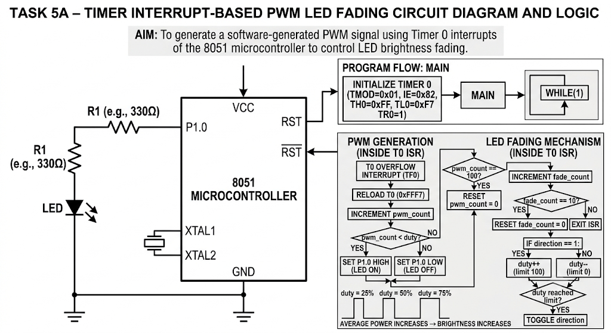

# Experiment – Timer 0 Interrupt-Based PWM LED Fading (8051)

## Aim
To generate a PWM signal using Timer 0 interrupts of the 8051 microcontroller and gradually increase and decrease the LED brightness to produce a fading effect.

## Hardware Requirements
- 8051 microcontroller (AT89S52)
- LED connected to Port 1, Pin 0 (P1.0)
- Current-limiting resistor
- Suitable power supply and clock circuit

## Pin Configuration

| Pin | Function |
|---|---|
| P1.0 | LED output |

## Working Principle

The program uses Timer 0 in Mode 1 (16-bit timer mode) to generate periodic interrupts. The Timer 0 interrupt service routine updates the LED output according to a software-generated PWM signal.

PWM controls the average power delivered to the LED by varying the ratio of ON time to the total PWM period. This ratio is called the duty cycle.

The program varies the duty cycle gradually from 0% to 100% and then back to 0%, creating a continuous LED fading effect.

## Timer 0 Configuration

- Timer used: Timer 0
- Mode: Mode 1 (16-bit timer)
- Timer mode register: `TMOD = 0x01`
- Initial timer value: `TH0 = 0xFF`, `TL0 = 0xF7`
- Timer interrupt enabled using `ET0 = 1`
- Global interrupts enabled using `EA = 1`
- Timer started using `TR0 = 1`

The timer is reloaded with `0xFFF7` inside the interrupt service routine.

## PWM Generation

The following variables are used to generate PWM:

| Variable | Purpose |
|---|---|
| `pwm_count` | Tracks the current position within the PWM cycle |
| `duty` | Stores the current PWM duty-cycle value (0–100) |
| `fade_count` | Controls how frequently the duty cycle changes |
| `direction` | Determines whether brightness is increasing or decreasing |

The PWM cycle consists of 100 interrupt steps.

- When `pwm_count < duty`, the LED output is set HIGH.
- Otherwise, the LED output is set LOW.
- `pwm_count` is incremented after every interrupt.
- When it reaches 100, it is reset to zero.

This produces a PWM signal whose duty cycle is controlled by the `duty` variable.

## LED Fading Mechanism

The LED brightness is changed gradually using the `fade_count` and `direction` variables.

1. After every 100 PWM interrupt steps, `fade_count` is incremented.
2. When `fade_count` reaches 10, it is reset to zero and the duty cycle is updated.
3. If `direction == 1`, the duty cycle increases by one until it reaches 100.
4. Once the maximum duty cycle is reached, the direction changes.
5. The duty cycle then decreases by one until it reaches zero.
6. The direction changes again, and the cycle repeats.

This produces a gradual increase and decrease in LED brightness.

## Program Flow

1. Initialize the LED output.
2. Configure Timer 0 in 16-bit Mode 1.
3. Load the initial timer value.
4. Enable Timer 0 interrupts and global interrupts.
5. Start Timer 0.
6. Execute an empty infinite loop in the main function.
7. Generate PWM and update the duty cycle inside the Timer 0 interrupt service routine.
8. Repeat the fading cycle continuously.

## Key Concepts Demonstrated
- 8051 Timer 0 configuration
- 16-bit timer operation
- Timer overflow interrupts
- Interrupt service routines
- Software PWM generation
- PWM duty-cycle control
- LED brightness control
- Gradual brightness fading
- Interrupt-driven embedded programming

## Observation

The LED connected to P1.0 gradually increases in brightness and then decreases in brightness. This fading cycle repeats continuously.

The main function remains free of delay loops because PWM generation and brightness updates are handled inside the Timer 0 interrupt service routine.

## Circuit diagram

