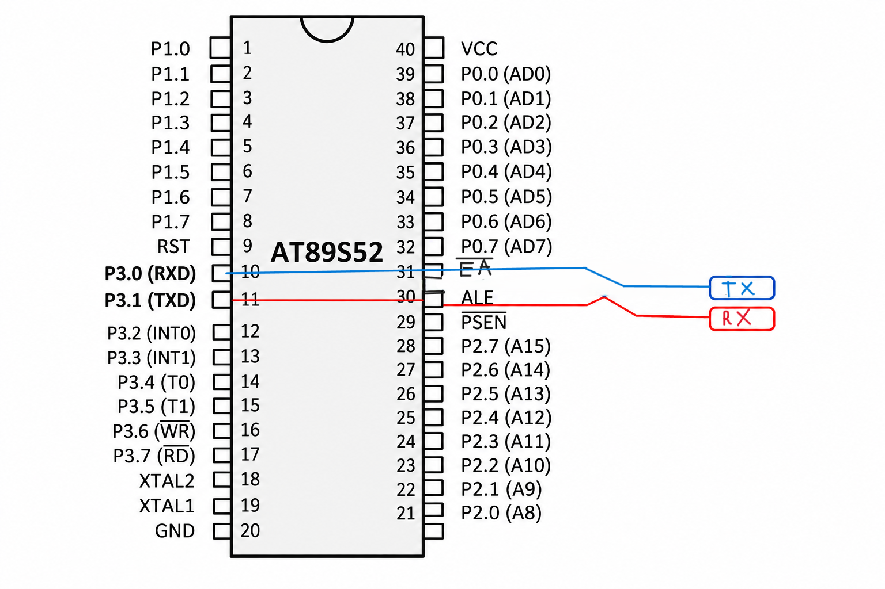

# Serial Communication Using Transmit and Receive Interrupts – 8051 Microcontroller

## Aim
To implement interrupt-driven serial communication using the 8051 microcontroller by demonstrating continuous transmission of a predefined message and reception of serial data with character echo functionality.

## Hardware Requirements
- 8051 Microcontroller
- Serial communication interface
- Power supply
- Keil µVision IDE
- Proteus (for simulation, if required)

## Software Requirements
- Embedded C
- Keil µVision
- 8051 Device Library (`reg51.h`)

## Description
This experiment consists of two independent implementations demonstrating interrupt-driven UART communication using the 8051 microcontroller.

Both implementations utilize the serial port in Mode 1 and Timer 1 in Mode 2 to establish serial communication at a baud rate of 9600.

### Part A: Interrupt-Driven Serial Transmission
The first implementation continuously transmits a predefined message (`"hello\r\n"`) through the UART.

The initial character is loaded into `SBUF` to initiate transmission. Whenever a character is transmitted, the Transmit Interrupt Flag (`TI`) generates an interrupt.

The interrupt service routine clears the flag, loads the next character into `SBUF`, and increments the message index. After the complete message is transmitted, the index is reset to repeat the sequence.

### Part B: Interrupt-Driven Serial Reception and Echo
The second implementation receives serial characters through the UART and echoes them back to the sender.

Whenever a character is received, the Receive Interrupt Flag (`RI`) generates an interrupt. The received character is read from `SBUF`, stored in a variable, and written back into `SBUF` for transmission.

The Transmit Interrupt Flag (`TI`) is cleared after transmission completion.

## Working Principle

### Common UART Configuration
| Register / Bit | Configuration | Purpose |
|---|---|---|
| `SCON` | `0x50` | UART Mode 1, reception enabled |
| `TMOD` | `0x20` | Timer 1 Mode 2 |
| `TH1` | `0xFD` | Baud rate reload value |
| `TR1` | `1` | Starts Timer 1 |
| `ES` | `1` | Enables serial interrupt |
| `EA` | `1` | Enables global interrupts |

### Part A: Transmission Sequence
1. Initialize the UART and Timer 1.
2. Enable serial and global interrupts.
3. Load the first character into `SBUF`.
4. Wait for the transmit interrupt.
5. Clear `TI` and load the next character.
6. Reset the index after transmitting the complete message.
7. Repeat the transmission continuously.

### Part B: Reception and Echo Sequence
1. Initialize the UART and Timer 1.
2. Enable serial and global interrupts.
3. Wait for incoming serial data.
4. On reception, clear `RI`.
5. Read the character from `SBUF`.
6. Store the character in a variable.
7. Load the received character into `SBUF` for transmission.
8. Clear `TI` when transmission completes.

## Key Concepts
- 8051 UART architecture
- Serial communication Mode 1
- Timer 1 auto-reload operation
- Interrupt-driven input/output
- Serial transmit and receive interrupts
- `SBUF`, `SCON`, and `TMOD` registers
- `TI` and `RI` interrupt flags
- Interrupt Service Routine (ISR)
- Non-blocking serial communication

## Expected Output

**Part A – Continuous Message Transmission**

```text
hello
hello
hello
...
```

**Part B – Character Echo**

```text
Input:  Embedded Systems
Output: Embedded Systems
```

Both operations use serial communication at 9600 baud, assuming an 11.0592 MHz crystal oscillator.

## Result
Two interrupt-driven serial communication implementations were developed using the 8051 microcontroller. The first implementation demonstrates continuous transmission of a predefined message, while the second demonstrates reception and echoing of serial characters. Both illustrate the use of UART interrupts for efficient serial data handling without continuous polling in the main program.

## Note
These are two separate implementations of UART interrupt handling and are not intended to execute simultaneously as a single program. The first focuses on transmit interrupt handling, while the second demonstrates receive interrupt handling along with transmit completion management.

## Circuit Diagram

