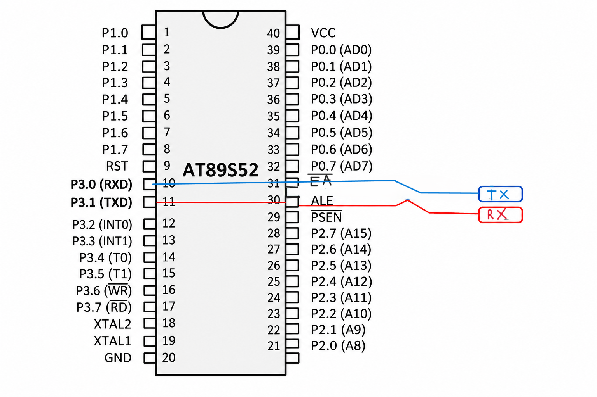

# Serial Data Transmission Using Interrupt – 8051 Microcontroller

## Aim
To implement serial data transmission using the 8051 microcontroller by configuring the UART and utilizing the serial transmit interrupt to continuously transmit a predefined message without blocking the main program execution.

## Hardware Requirements
- 8051 Microcontroller
- Serial communication interface
- Power supply
- Keil µVision IDE
- Proteus (for simulation, if required)

## Software Requirements
- Embedded C
- Keil µVision
- 8051 Device Library (`reg51.h`)

## Description
This experiment demonstrates interrupt-driven serial data transmission using the UART peripheral of the 8051 microcontroller.

The serial port is configured in Mode 1, which supports 8-bit UART communication with variable baud rate. Timer 1 is configured in Mode 2 (8-bit auto-reload mode) to generate the baud rate required for serial communication.

The predefined message `"hello\r\n"` is transmitted character by character. The first character is loaded into the serial buffer (`SBUF`) to initiate transmission. Once a character has been transmitted, the Transmit Interrupt Flag (`TI`) is set, generating a serial interrupt.

Inside the interrupt service routine:
- The `TI` flag is cleared.
- The next character is loaded into `SBUF`.
- The index is incremented to access the subsequent character.
- Once the complete message is transmitted, the index is reset to repeat the transmission.

This process enables continuous transmission without requiring software delay loops or continuous polling in the main program.

## Working Principle
1. Configure the serial port using `SCON = 0x50`.
2. Configure Timer 1 in Mode 2 using `TMOD`.
3. Load `TH1 = 0xFD` to generate a baud rate of 9600 baud with a standard 11.0592 MHz crystal.
4. Start Timer 1 using `TR1`.
5. Enable serial and global interrupts using `ES` and `EA`.
6. Load the first character into `SBUF`.
7. On every transmit interrupt, send the next character.
8. Reset the index after transmitting the complete message.

## Key Concepts
- UART serial communication
- 8051 Serial Port Mode 1
- Timer 1 auto-reload mode
- Transmit Interrupt Flag (`TI`)
- Serial Interrupt Service Routine (ISR)
- Non-blocking data transmission

## Expected Output
The message below is continuously transmitted through the serial port at 9600 baud:

```text
hello
hello
hello
...
```

Each transmission includes carriage return (`\r`) and newline (`\n`) characters.
## Circuit Diagram

## Result
Interrupt-driven serial data transmission was implemented successfully using the 8051 microcontroller. The predefined message is transmitted continuously through the UART using the serial transmit interrupt, allowing the main program to remain available for other operations.

## Note
The baud rate of 9600 is obtained when the system uses an 11.0592 MHz crystal oscillator. The transmission sequence is initiated by writing the first character to `SBUF`, while subsequent characters are transmitted through the interrupt service routine.
