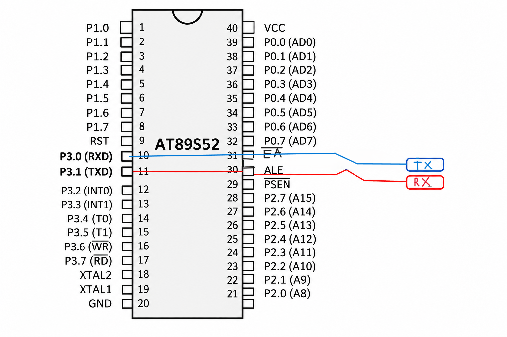

# Serial Data Reception and Echo Using Interrupt – 8051 Microcontroller

## Objective
To implement interrupt-driven serial data reception using the 8051 microcontroller and transmit the received character back to the sender using UART communication.

## Hardware Requirements
- 8051 Microcontroller
- Serial communication interface
- Power supply
- Keil µVision IDE


## Software Requirements
- Embedded C
- Keil µVision
- 8051 Device Library (`reg51.h`)

## Description
This experiment demonstrates serial data reception and character echo using the UART peripheral and serial interrupt of the 8051 microcontroller.

The serial port is configured in Mode 1 (8-bit UART communication), while Timer 1 operates in Mode 2 (8-bit auto-reload mode) to generate the required baud rate.

When a character is received through the serial port, the Receive Interrupt Flag (`RI`) is set, generating a serial interrupt.

Inside the interrupt service routine:
- The `RI` flag is cleared.
- The received character is read from the serial buffer (`SBUF`).
- The received character is stored in the variable `c`.
- The character is written back into `SBUF` for transmission.

The transmitted character is therefore echoed back to the sender.

The Transmit Interrupt Flag (`TI`) is also checked and cleared to ensure proper handling of transmission completion.

## Working Principle
1. Configure the serial port using `SCON = 0x50`.
2. Configure Timer 1 in Mode 2 using `TMOD`.
3. Load `TH1 = 0xFD` for a baud rate of 9600 with an 11.0592 MHz crystal.
4. Start Timer 1 using `TR1`.
5. Enable serial and global interrupts using `ES` and `EA`.
6. Wait for incoming serial data.
7. When a character is received, the serial interrupt is generated.
8. Read the received character from `SBUF`.
9. Write the same character back into `SBUF` to echo it.
10. Clear the transmit interrupt flag when transmission is completed.

## Key Concepts
- UART serial communication
- Serial Port Mode 1
- Timer 1 auto-reload mode
- Receive Interrupt Flag (`RI`)
- Transmit Interrupt Flag (`TI`)
- Serial Interrupt Service Routine (ISR)
- Character echo operation
## Circuit Diagram

## Expected Output
When a character or string is entered through a serial terminal, the 8051 microcontroller transmits the same character or string back to the terminal.

Example:

```text
Input:  HELLO
Output: HELLO
```

The output is displayed on the serial terminal at 9600 baud.

