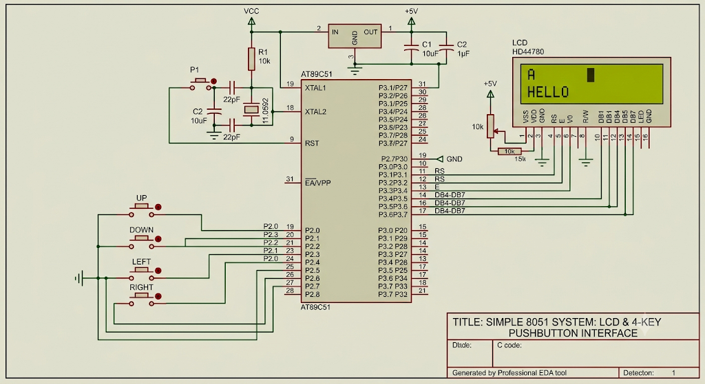

# Experiment: LCD Cursor Positioning and Integer Display using 8051

## Objective
To interface a 16×2 LCD with the 8051 microcontroller, implement cursor positioning, and display integer values by converting them into their corresponding ASCII characters.

## Hardware Requirements
- AT89S52 (8051) Microcontroller
- 16×2 LCD Display
- Connecting wires
- Power supply

## Pin Connections

| LCD Pin | 8051 Connection |
|---|---|
| RS | P3.2 |
| E | P3.3 |
| D4–D7 | P3.4–P3.7 |
| RW | GND |
| VSS | GND |
| VDD | +5V |

## Implementation

The LCD operates in 4-bit communication mode. In addition to the basic LCD initialization and data transmission functions, this program implements cursor positioning and integer display.

The program implements the following functions:

- `lcd_send_nibble()` – Transmits 4 bits of data to the LCD.
- `lcd_cmd()` – Sends LCD control commands.
- `lcd_data()` – Displays individual characters.
- `lcd_init()` – Initializes the LCD in 4-bit, two-line mode.
- `lcd_goto()` – Positions the cursor at a specified row and column.
- `lcd_puts()` – Displays a string.
- `lcd_print_number()` – Converts an unsigned integer into individual decimal digits and displays them in the correct order.

### Integer Conversion Logic

The integer is converted into ASCII digits using repeated division and modulus operations.

1. Extract the last digit using `value % 10`.
2. Convert the digit into its ASCII equivalent by adding `'0'`.
3. Store the digit in an array.
4. Remove the extracted digit using `value / 10`.
5. Display the stored digits in reverse order to obtain the correct number.

A special condition handles the value zero separately.

## Circuit Diagram

## Output

For the integer value `1234`:

- First row: `VALUE:`
- Second row: `1234`

