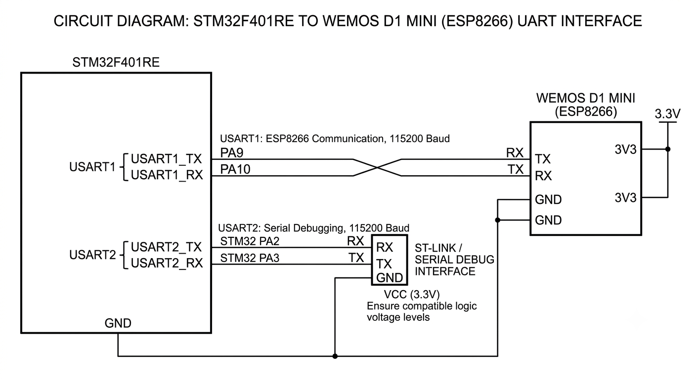

## STM32–ESP8266 UART Communication & Wi-Fi Configuration

This project demonstrates UART-based communication between an STM32F401RE microcontroller and a Wemos D1 Mini (ESP8266) module. The STM32 sends AT commands to configure the ESP8266 as a Wi-Fi station, connect it to a wireless network, and retrieve network information.

The ESP8266 handles the Wi-Fi operations internally, while the STM32 manages command transmission and response processing through its UART peripherals.

## System Overview

The project uses two UART interfaces:

* USART1: Communication between the STM32 and ESP8266.
* USART2: Debugging interface used to monitor ESP8266 responses through a serial terminal.

The STM32 transmits AT commands over USART1 and receives the corresponding responses from the ESP8266. These responses are then forwarded to USART2 for monitoring.

## Communication Workflow

The firmware follows this sequence:

1. Initializes the STM32 system clock and UART peripherals.
2. Waits for the ESP8266 to complete its startup sequence.
3. Sends AT to verify UART communication.
4. Configures the ESP8266 in Station mode using AT+CWMODE=1.
5. Connects to the specified Wi-Fi network using AT+CWJAP.
6. Retrieves the assigned IP address using AT+CIFSR.
7. Checks the network connection status using AT+CIPSTATUS.
8. Forwards received ESP8266 responses to the serial debugging terminal.

## AT Command Reference

Command	Description
AT	Checks communication with the ESP8266.
AT+CWMODE=1	Configures the ESP8266 as a Wi-Fi Station.
AT+CWJAP	Connects to a Wi-Fi network using its SSID and password.
AT+CIFSR	Retrieves the ESP8266’s assigned IP address.
AT+CIPSTATUS	Checks the current TCP/IP connection status.

## UART Configuration

Parameter	USART1	USART2
Interface	ESP8266	Serial Debugging
Baud Rate	115200	115200
Data Bits	8	8
Stop Bits	1	1
Parity	None	None
Mode	TX/RX	TX/RX

## Hardware Connections

STM32F401RE	Wemos D1 Mini (ESP8266)
USART1 TX	RX
USART1 RX	TX
GND	GND

USART2 is used separately as the debugging interface and is connected to a serial terminal through the appropriate USB/serial connection.

## Hardware considerations:

* Ensure a common ground between the STM32 and ESP8266.
* Verify that the UART logic levels are compatible.
* Provide a stable power supply capable of handling the ESP8266’s current requirements.

## Expected Output

The serial terminal displays the responses received from the ESP8266, allowing the communication and Wi-Fi configuration process to be monitored.

## Typical responses include:

* OK – AT command successfully processed.
* WIFI CONNECTED – ESP8266 successfully connected to the wireless network.
* WIFI GOT IP – Network address successfully assigned.
* +CIFSR – Displays the assigned local IP address.
* STATUS: 2 – Indicates a successful connection to an access point.

## Technical Stack

Component	Technology
Microcontroller	STM32F401RE
Wi-Fi Module	ESP8266 (Wemos D1 Mini)
Communication Protocol	UART
Module Configuration	ESP8266 AT Commands
Firmware	Embedded C
Peripheral Library	STM32 HAL
Development Environment	STM32CubeIDE
Debugging Tool	PuTTY / Serial Terminal

## Key Concepts

* UART-based serial communication
* Interfacing external Wi-Fi modules with STM32
* AT command transmission and response handling
* Wi-Fi Station mode configuration
* IP address retrieval and network status monitoring
* UART-based debugging

## Circuit Diagram

