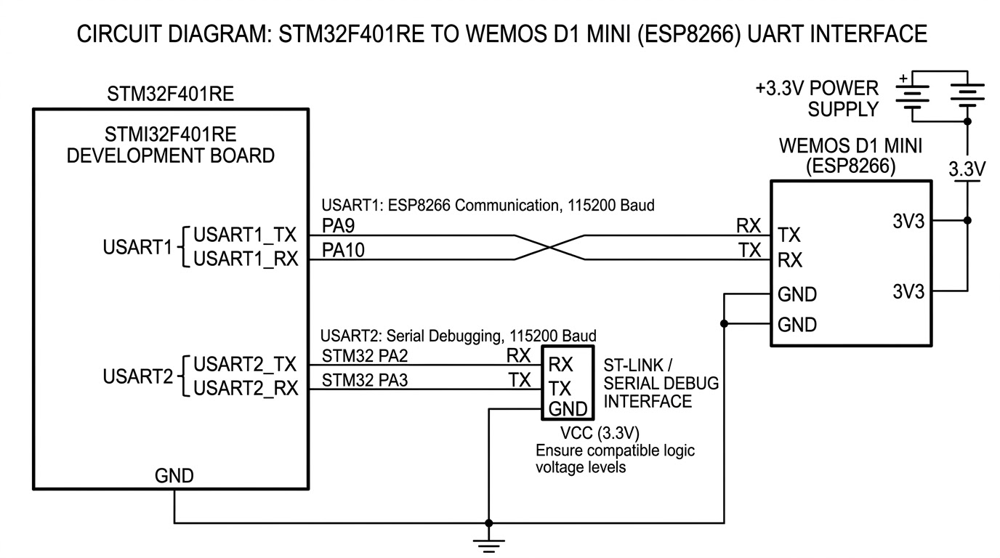

#### STM32 UART Communication with ESP8266 Using AT Commands

This project demonstrates UART-based communication between an STM32F401RE microcontroller and a Wemos D1 Mini (ESP8266) module. The STM32 communicates with the ESP8266 using AT commands to configure its Wi-Fi interface, establish a wireless network connection, and retrieve network information such as the assigned IP address and connection status.

The implementation uses USART1 for communication with the ESP8266 and USART2 as a separate debugging interface to monitor the responses through a serial terminal.

## System Overview

The STM32 acts as the host controller, sending AT commands to the ESP8266 and processing the responses returned by the module.

Two UART peripherals are used:

* USART1: Handles bidirectional communication between the STM32 and ESP8266.
* USART2: Forwards received responses to a serial terminal for debugging and monitoring.

The ESP8266 uses its existing AT firmware to execute the received commands. Wi-Fi configuration and network operations are handled internally by the module, while the STM32 controls the command sequence.

## Communication Configuration

Both UART peripherals are configured with the following parameters:

Parameter	USART1	USART2
Purpose	STM32–ESP8266 Communication	Serial Debugging
Baud Rate	115200 bps	115200 bps
Data Bits	8	8
Stop Bits	1	1
Parity	None	None
Mode	TX/RX	TX/RX

The interfaces use the standard 8-N-1 UART configuration.

## Working Principle

The STM32 communicates with the ESP8266 through USART1 using AT commands. Responses received from the module are forwarded byte by byte through USART2 and displayed on a serial terminal.

A custom send() function is implemented to transmit AT commands and receive the corresponding responses using a specified timeout. This provides a reusable mechanism for handling the command-response sequence.

The firmware follows this execution sequence:

1. Initializes the STM32 HAL library and configures the system clock.
2. Initializes USART1 and USART2 with a baud rate of 115200 bps.
3. Introduces a 2-second delay to allow the ESP8266 to complete its startup sequence.
4. Transmits the AT command to verify communication with the module.
5. Sends AT+CWMODE=1 to configure the ESP8266 in Wi-Fi Station mode.
6. Sends AT+CWJAP along with the Wi-Fi SSID and password to connect to the wireless network.
7. Sends AT+CIFSR to retrieve the IP address assigned to the ESP8266.
8. Sends AT+CIPSTATUS to retrieve the current network connection status.
9. Forwards the received responses through USART2 to the serial debugging terminal.

## AT Command Reference

AT Command	Description
AT	Verifies communication with the ESP8266.
AT+CWMODE=1	Configures the ESP8266 in Wi-Fi Station mode.
AT+CWJAP="SSID","PASSWORD"	Connects the ESP8266 to the specified wireless network.
AT+CIFSR	Retrieves the IP address assigned to the ESP8266.
AT+CIPSTATUS	Checks the current TCP/IP connection status.

Note: Replace SSID and PASSWORD with the credentials of the Wi-Fi network being used.

## UART Communication and Response Handling

The send() function handles the transmission of AT commands and reception of ESP8266 responses.

Its primary operations include:

* Transmitting the command through USART1.
* Receiving the response from the ESP8266 with a specified timeout.
* Forwarding received bytes through USART2.
* Displaying the module responses on the serial terminal.

Using a separate debugging UART makes it possible to monitor the ESP8266 communication without interfering with the primary STM32–ESP8266 interface.

## Hardware Requirements

Component	Description
STM32F401RE Development Board	Main microcontroller
Wemos D1 Mini (ESP8266)	Wi-Fi communication module
USB-to-Serial Interface	Serial debugging
Jumper Wires	Hardware connections

## Hardware Connections

STM32 to ESP8266

STM32F401RE	Wemos D1 Mini (ESP8266)
USART1 TX	RX
USART1 RX	TX
GND	GND

USART2 is used separately for serial debugging through the STM32 serial interface.

## Hardware Considerations:

* TX and RX connections must be crossed between the two devices.
* Both boards must share a common ground.
* Ensure compatible UART logic voltage levels.
* The ESP8266 must receive a stable 3.3 V supply capable of handling its current requirements.

## Software Requirements

* STM32CubeIDE: Firmware development, compilation, and debugging.
* STM32 HAL Library: UART peripheral configuration and communication.
* PuTTY: Monitoring UART responses through a serial terminal.
* Embedded C: Firmware implementation.

## Expected Output

The serial terminal displays the responses returned by the ESP8266 during the configuration process.

## Typical responses include:

Response	Interpretation
OK	AT command successfully processed.
WIFI CONNECTED	ESP8266 successfully connected to the wireless network.
WIFI GOT IP	ESP8266 obtained an IP address.
+CIFSR:STAIP,...	Displays the assigned Station IP address.
STATUS: 2	Indicates a successful connection to an access point.

The exact responses may vary depending on the ESP8266 AT firmware version and network conditions.

## Technical Specifications

Specification	Details
Microcontroller	STM32F401RE
Wi-Fi Module	Wemos D1 Mini (ESP8266)
Communication Protocol	UART
Primary Interface	USART1
Debugging Interface	USART2
Baud Rate	115200 bps
Command Interface	ESP8266 AT Commands
Programming Language	Embedded C
Peripheral Library	STM32 HAL
Development Environment	STM32CubeIDE
Serial Terminal	PuTTY

## Key Concepts Demonstrated

* UART-based communication between microcontrollers and external modules.
* STM32 peripheral configuration using the HAL library.
* AT command transmission and response handling.
* Wi-Fi Station mode configuration.
* Wireless network association using ESP8266.
* IP address retrieval and TCP/IP connection status monitoring.
* Debugging through an independent UART interface.

## Circuit Diagram

