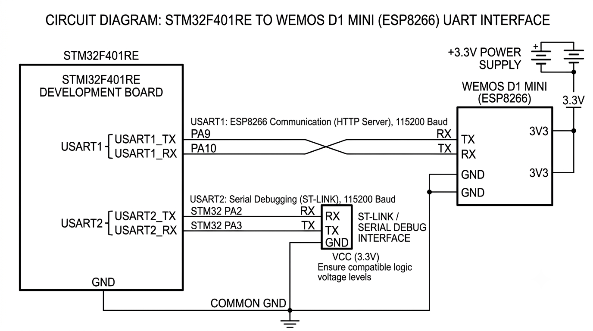

# STM32-Based ESP8266 HTTP Server

An embedded web server implementation using an STM32F401RE microcontroller and a Wemos D1 Mini (ESP8266). The STM32 communicates with the ESP8266 through UART using AT commands and handles incoming HTTP requests directly.

## Overview

The ESP8266 is configured as a Wi-Fi station and TCP server on port 80. Once connected to the network, it allows devices on the same network to access the STM32-hosted HTTP response through a web browser.

The ESP8266 handles the Wi-Fi connection and TCP communication, while the STM32 processes incoming data and constructs the HTTP response.

## Implementation

- **UART Communication:** USART1 handles bidirectional communication between the STM32 and ESP8266 at 115200 baud.
- **Serial Debugging:** USART2 forwards received ESP8266 data to PuTTY for monitoring.
- **Wi-Fi Configuration:** AT commands configure Station mode and connect the ESP8266 to the specified wireless network.
- **TCP Server:** `AT+CIPMUX=1` enables multiple connections, and `AT+CIPSERVER=1,80` starts the server on port 80.
- **Request Detection:** The STM32 continuously monitors UART data and identifies incoming `+IPD` notifications.
- **Request Parsing:** The connection ID and incoming payload length are extracted from the `+IPD` header.
- **HTTP Response:** The STM32 sends an HTTP 200 OK response containing the text `Dr.Dinesh is GREAT!!!`.
- **Connection Management:** `AT+CIPSEND` transmits the response, and `AT+CIPCLOSE` closes the browser connection.

## Hardware Connections

| STM32F401RE | Wemos D1 Mini |
|---|---|
| USART1 TX | RX |
| USART1 RX | TX |
| GND | GND |

USART2 is connected to the serial debugging interface.

## Software & Tools

- STM32CubeIDE
- Embedded C
- STM32 HAL Library
- ESP8266 AT Firmware
- PuTTY

## Configuration

| Parameter | Value |
|---|---|
| Microcontroller | STM32F401RE |
| Wi-Fi Module | ESP8266 |
| Communication | UART |
| Baud Rate | 115200 |
| Server Protocol | HTTP over TCP |
| Server Port | 80 |
| UART Debugging | USART2 |

## How It Works

1. The STM32 initializes both UART peripherals and allows the ESP8266 to boot.
2. AT commands configure the Wi-Fi connection and start a TCP server on port 80.
3. When a browser accesses the ESP8266's assigned IP address, the module forwards the incoming request through UART.
4. The STM32 detects the `+IPD` header and extracts the connection ID and request length.
5. The incoming HTTP request payload is read from UART.
6. The STM32 sends an HTTP response using `AT+CIPSEND`.
7. After transmission, the TCP connection is closed using `AT+CIPCLOSE`.

## Notes

- The ESP8266 is responsible for Wi-Fi connectivity and TCP server functionality.
- HTTP request detection, response construction and connection handling are implemented on the STM32.
- The implementation uses blocking UART communication through the STM32 HAL library.
- The browser and ESP8266 must be connected to the same local network.
  
## Circuit Diagram

