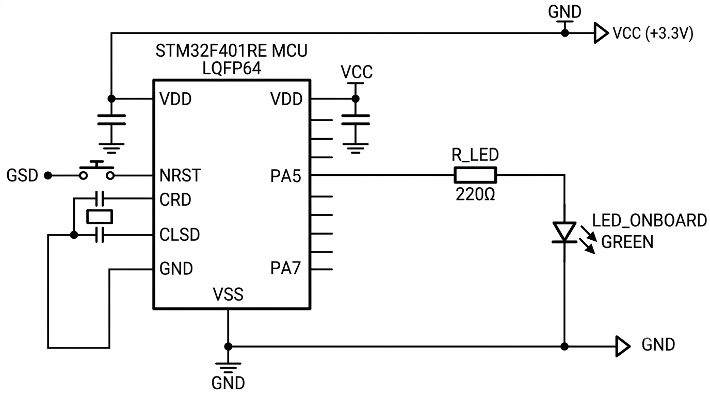

# STM32 GPIO – LED Blinking

A basic GPIO output implementation using the STM32F401RE microcontroller and STM32 HAL library. The program toggles the onboard LED connected to GPIO pin PA5 at a fixed time interval.

## Implementation

- **GPIO Configuration:** GPIOA clock is enabled and PA5 is configured as a general-purpose push-pull output.
- **Initial State:** PA5 is initialized to LOW before entering the main loop.
- **LED Control:** `HAL_GPIO_TogglePin()` is used to alternate the output state of PA5.
- **Timing:** `HAL_Delay()` introduces a 500 ms delay between successive toggles.
- **Continuous Execution:** The LED toggling operation runs indefinitely inside the main loop.

## Clock Configuration

The system clock is configured using the internal High-Speed Internal (HSI) oscillator and PLL.

| Parameter | Configuration |
|---|---|
| Clock Source | HSI |
| HSI Frequency | 16 MHz |
| PLLM | 8 |
| PLLN | 84 |
| PLLP | 2 |
| System Clock | 84 MHz |
| AHB Prescaler | 1 |
| APB1 Prescaler | 2 |
| APB2 Prescaler | 1 |

## GPIO Configuration

| Parameter | Configuration |
|---|---|
| GPIO Port | GPIOA |
| Pin | PA5 |
| Mode | Output Push-Pull |
| Pull-up/Pull-down | No Pull |
| Output Speed | Low |
| Initial State | LOW |

## Hardware

- STM32F401RE Development Board
- Onboard LED connected to PA5

## Software & Tools

- STM32CubeIDE
- Embedded C
- STM32 HAL Library

## Working

The LED starts in the OFF state. Inside the infinite loop, the output state of PA5 is inverted using `HAL_GPIO_TogglePin()`. A 500 ms delay follows each toggle, producing a continuous blinking pattern with a 1-second complete ON-OFF cycle.

## Circuit Diagram

## Key Functions

| Function | Purpose |
|---|---|
| `HAL_Init()` | Initializes the HAL library |
| `SystemClock_Config()` | Configures the system clock |
| `MX_GPIO_Init()` | Initializes GPIO peripherals |
| `HAL_GPIO_TogglePin()` | Toggles the LED output |
| `HAL_Delay()` | Generates the 500 ms delay |

