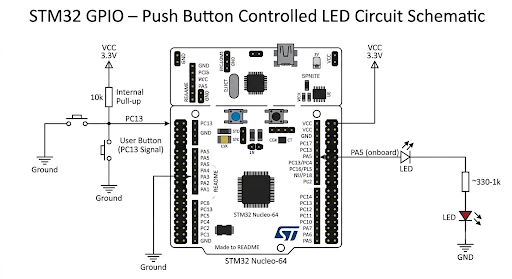

# STM32 GPIO – Push Button Controlled LED

A push-button-controlled LED implementation using the STM32F401RE microcontroller and STM32 HAL library. The onboard button (PC13) is used to toggle the onboard LED (PA5), with software debouncing to prevent false triggers caused by mechanical switch bouncing.

## Implementation

- **Button Input:** GPIOC pin 13 is configured as an input with an internal pull-up resistor.
- **Active-Low Logic:** The button is active-low, meaning PC13 reads LOW when pressed and HIGH when released.
- **Software Debouncing:** A 50 ms delay is introduced after detecting a button press, followed by a second read to verify the press.
- **LED Control:** `HAL_GPIO_TogglePin()` toggles the LED state on PA5 whenever a valid button press is detected.
- **Press Detection:** The program waits until the button is released before accepting another press.
- **Release Debouncing:** An additional 50 ms delay is applied after release to prevent unintended triggering.

## GPIO Configuration

| Parameter | Button | LED |
|---|---|---|
| GPIO Pin | PC13 | PA5 |
| Mode | Input | Output Push-Pull |
| Pull Configuration | Pull-up | No Pull |
| Active State | LOW | Toggle |
| Initial State | — | LOW |

## Clock Configuration

The system clock uses the internal HSI oscillator with PLL configuration.

| Parameter | Value |
|---|---|
| Clock Source | HSI |
| PLLM | 8 |
| PLLN | 84 |
| PLLP | 2 |
| System Clock | 84 MHz |
| AHB Prescaler | 1 |
| APB1 Prescaler | 2 |
| APB2 Prescaler | 1 |

## Working

The LED initially remains OFF. When the onboard button is pressed, the program verifies the input after a 50 ms debounce interval. If the press is valid, the LED state is toggled.

The program then waits for the button to be released before accepting another press. This ensures that holding the button does not repeatedly toggle the LED.

Each valid button press produces exactly one LED state change.

## Circuit Diagram

## Key HAL Functions

| Function | Purpose |
|---|---|
| `HAL_GPIO_ReadPin()` | Reads the button state |
| `HAL_GPIO_TogglePin()` | Toggles the LED |
| `HAL_Delay()` | Implements software debouncing |
| `HAL_GPIO_Init()` | Configures GPIO pins |
| `HAL_GPIO_WritePin()` | Sets the initial LED state |

## Software & Tools

- STM32CubeIDE
- Embedded C
- STM32 HAL Library
- STM32F401RE Development Board
