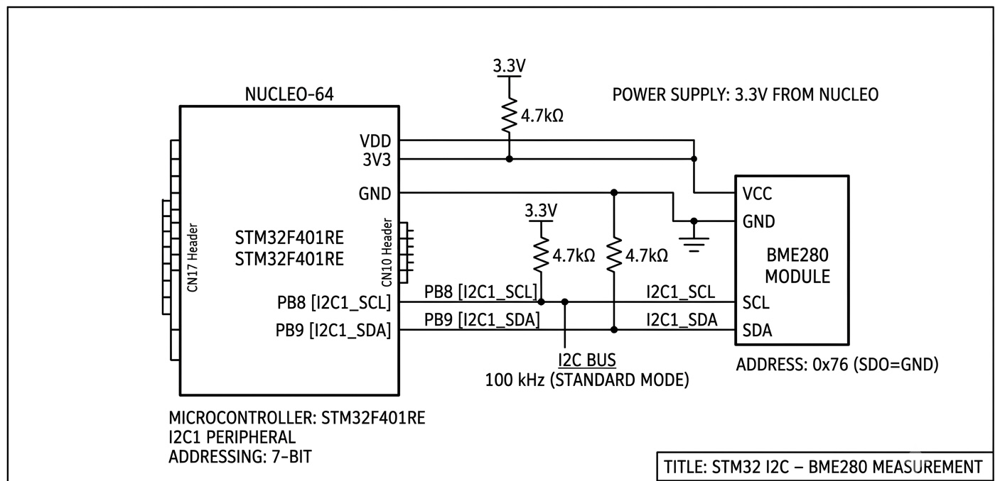

# STM32 I2C – BME280 Temperature, Pressure and Humidity Measurement

This program interfaces the BME280 environmental sensor with an STM32F401RE microcontroller using the I2C communication protocol. It reads temperature, atmospheric pressure and relative humidity from the sensor at one-second intervals using the Bosch BME280 Sensor API and STM32 HAL drivers.

## Implementation

- **Microcontroller:** STM32F401RE
- **Sensor:** BME280
- **Communication:** I2C1
- **I2C Speed:** 100 kHz
- **Sensor Address:** `0x76` (`BME280_I2C_ADDR_PRIM`)
- **Operating Mode:** Normal mode
- **Measurement Interval:** 1 second

## Sensor Configuration

The BME280 is configured with the following settings:

| Parameter | Configuration |
|---|---|
| Temperature Oversampling | 1x |
| Pressure Oversampling | 1x |
| Humidity Oversampling | 1x |
| Filter | Disabled |
| Standby Time | 1000 ms |
| Operating Mode | Normal |

## I2C Communication

The Bosch BME280 Sensor API is used to communicate with the sensor. The following callback functions connect the sensor API to the STM32 HAL I2C driver:

- `user_i2c_read()` – Reads sensor registers using `HAL_I2C_Mem_Read()`.
- `user_i2c_write()` – Writes data to sensor registers using `HAL_I2C_Mem_Write()`.
- `user_delay_us()` – Provides the delay callback required by the sensor API using `HAL_Delay()`.

The BME280 device structure is initialized with these callbacks and the I2C device address.

## How It Works

1. Initializes the STM32 HAL, system clock, GPIO and I2C1 peripheral.
2. Configures the BME280 device structure with its I2C address and communication callbacks.
3. Initializes the sensor using `bme280_init()`.
4. Configures temperature, pressure and humidity oversampling, filter and standby time.
5. Sets the sensor to normal operating mode.
6. Reads all three measurement parameters using `bme280_get_sensor_data()`.
7. Stores the compensated measurements in the following variables:
   - `temperature` – Temperature in °C.
   - `pressure` – Atmospheric pressure in hPa (converted from Pa by dividing by 100).
   - `humidity` – Relative humidity in %.
8. Repeats the measurement process at one-second intervals.

## Key Functions

| Function | Purpose |
|---|---|
| `bme280_init()` | Initializes the BME280 sensor |
| `bme280_set_sensor_settings()` | Configures oversampling, filter and standby settings |
| `bme280_set_sensor_mode()` | Sets the sensor operating mode |
| `bme280_get_sensor_data()` | Retrieves compensated temperature, pressure and humidity |
| `HAL_I2C_Mem_Read()` | Reads data from BME280 registers |
| `HAL_I2C_Mem_Write()` | Writes configuration data to BME280 registers |
| `HAL_GetTick()` | Not used in this implementation |

## I2C Configuration

- Peripheral: I2C1
- Clock Speed: 100 kHz
- Addressing Mode: 7-bit
- Duty Cycle: 2
- Address: `0x76`

The HAL driver shifts the 7-bit sensor address left by one bit when passing it to the STM32 I2C functions.

## Hardware Connections

Connect the BME280 module to the STM32 I2C1 interface:

| BME280 Pin | STM32F401RE |
|---|---|
| VCC | 3.3V |
| GND | GND |
| SCL | PB8 (I2C1_SCL, if configured in CubeMX) |
| SDA | PB9 (I2C1_SDA, if configured in CubeMX) |

## Circuit Diagram

## Software & Tools

- STM32CubeIDE
- STM32 HAL Library
- Bosch BME280 Sensor API
- STM32F401RE Nucleo board
- BME280 environmental sensor

**Note:** The program stores the measured values in variables but does not currently transmit or display them through UART, a serial monitor or another output interface.
