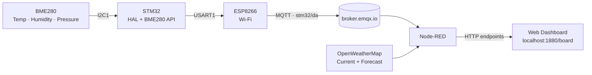

<div align="center">

#  Hyper-Local Moisture Advisory & Mold Prevention System

**An STM32 + Node-RED system that compares your indoor air with the weather outside, and tells you when to open the window.**


</div>

---

##  Table of Contents

- [Overview](#-overview)
- [System Architecture](#-system-architecture)
- [Part 1: STM32 Data Acquisition](#-part-1-stm32-data-acquisition)
- [Part 2: Node-RED Advisory Dashboard](#-part-2-node-red-advisory-dashboard)
- [Environmental Analysis](#-environmental-analysis)
- [Mold Risk Assessment](#-mold-risk-assessment)
- [Ventilation Recommendations](#-ventilation-recommendations)
- [Dashboard Features](#-dashboard-features)
- [Tech Stack](#-tech-stack)
- [Getting Started](#-getting-started)
- [Important Notes](#-important-notes)
- [Gallery](#-gallery)

---

##  Overview

Damp air, condensation and mold rarely announce themselves until it is too late. This project watches for them early.

A **BME280** sensor connected to an **STM32** measures indoor temperature, humidity and pressure. The readings are formatted as JSON and sent over **MQTT** through an **ESP8266** Wi-Fi module. **Node-RED** receives the data, fetches live outdoor conditions from the **OpenWeatherMap API**, and compares the two atmospheres.

The result is a live web dashboard showing measurements, derived parameters, risk indicators and plain-language ventilation advice, so you know whether opening a window will help or make things worse.

---

## System Architecture



The implementation has two connected halves:

| Layer | Role |
|---|---|
| **STM32 firmware** | Reads the sensor, builds the JSON payload, publishes over MQTT |
| **Node-RED** | Receives indoor data, fetches outdoor weather, computes metrics, serves the dashboard |

---

##  Part 1: STM32 Data Acquisition

### How it works

1. The BME280 communicates with the STM32 over **I2C1**.
2. The STM32 initializes the sensor using the **BME280 Sensor API**.
3. Temperature, humidity and pressure are acquired periodically.
4. Pressure is converted from **Pa to hPa**.
5. The readings are packed into a **JSON payload**.
6. The ESP8266 joins Wi-Fi and opens a **TCP connection** to the MQTT broker.
7. An MQTT session is established and data is published **every second**.

### MQTT configuration

| Parameter | Value |
|---|---|
| Broker | `broker.emqx.io` |
| Port | `1883` |
| Protocol | MQTT |
| Client ID | `STM32_da` |
| Topic | `stm32/da` |
| QoS | `0` |
| Publish interval | `1000 ms` |

### Payload format

```json
{
  "temperature": 27.45,
  "pressure": 1008.23,
  "humidity": 55.12
}
```

---

## Part 2: Node-RED Advisory Dashboard

Node-RED is the processing and visualization layer. It listens for indoor readings over MQTT, pulls outdoor weather from OpenWeatherMap, and exposes the processed results through HTTP endpoints.

### Data acquisition schedule

| Source | Details | Refresh |
|---|---|---|
| Indoor sensor | `stm32/da` MQTT topic, latest valid reading only | Live |
| Outdoor current weather | OpenWeatherMap Current Weather API | Every **10 min** |
| Outdoor forecast | OpenWeatherMap Forecast API, 8 three-hour steps (~24 h) | Every **30 min** |
| Dashboard UI | Polls the HTTP endpoints | Every **10 s** |

**Dashboard URL:** [`http://localhost:1880/board`](http://localhost:1880/board)

---

##  Environmental Analysis

Indoor measurements and outdoor weather are combined into several derived parameters.

| # | Parameter | What it tells you |
|---|---|---|
| 1 | **Absolute humidity** (g/m³) | The actual mass of water vapour in a volume of air, a fairer indoor/outdoor comparison than relative humidity alone |
| 2 | **Dew point** | The temperature at which vapour starts condensing into liquid, calculated for both indoor and outdoor air |
| 3 | **Indoor vs. outdoor moisture** | Whether bringing in outside air will lower or raise indoor moisture; the basis of the ventilation advice |
| 4 | **Condensation margin** | Indoor dew point compared with an adjustable assumed surface temperature, adjustable from the dashboard |
| 5 | **Wood equilibrium moisture content** | Estimated with the Hailwood-Horrobin equation, a useful indicator for wooden furniture and musical instruments |
| 6 | **Outdoor pressure trend** | Forecast data is scanned for significant predicted pressure rises or drops |

---

##  Mold Risk Assessment

A rule-based score with a **maximum of 6** evaluates indoor conditions:

| Parameter | Condition | Points |
|---|---|---|
| Relative humidity | 60% to 69% | +1 |
| Relative humidity | 70% to 79% | +2 |
| Relative humidity | 80% or higher | +3 |
| Dew point | 22 °C or higher | +1 |
| Condensation margin | Below 2 °C | +1 |
| Condensation margin | 0 °C or lower | +2 |

The score maps to four advisory levels:

| Level | Meaning |
|---|---|
| 🟢 **Low mold risk** | Conditions are comfortable |
| 🟡 **Worth watching** | Keep an eye on humidity |
| 🟠 **Mold risk is rising** | Act soon |
| 🔴 **Mold conditions are present** | Act now |

A **hysteresis mechanism** is built into the level transitions, so the displayed risk does not flicker when readings hover near a threshold.

> [!NOTE]
> The score is an environmental advisory indicator. It is not a direct measurement or prediction of mold growth.

---

##  Ventilation Recommendations

| Recommendation | When it appears |
|---|---|
|  **Open the windows** | Outdoor air holds significantly less moisture than indoor air, and it is not raining |
|  **Keep windows closed** | Outdoor air holds more moisture, or rain is detected |
|  **Ventilation changes little** | Indoor and outdoor absolute humidity are roughly equal |
|  **Mechanical dehumidification** | Indoor humidity is elevated and outdoor ventilation is unsuitable |
|  **Best time to ventilate** | A suitable upcoming forecast window where outdoor air is expected to be drier |

---

##  Dashboard Features

**Live monitoring**
- Indoor and outdoor temperature and relative humidity
- Sensor and API connectivity status indicators
- Automatic refresh every 10 seconds

**Analysis**
- Absolute humidity and dew point comparisons
- Mold risk score with contributing factors
- Condensation margin analysis with an adjustable surface temperature
- Wood equilibrium moisture assessment
- Detailed numerical comparison table
- Mathematical explanations of every derived parameter

**Forecast and guidance**
- Outdoor weather forecast visualization
- Forecast-based ventilation opportunities
- Outdoor atmospheric pressure trend
- Ventilation recommendations

**Look and feel**
- Dynamic, weather-responsive backgrounds and visual elements

---

##  Tech Stack

| Area | Tools |
|---|---|
| **STM32 firmware** | STM32CubeIDE · STM32 HAL · BME280 Sensor API · ESPLib · ESP8266 AT-command firmware |
| **Interfaces** | I2C · UART · MQTT |
| **Node-RED nodes** | MQTT in · HTTP request · Function · Template · HTTP in / response |
| **Frontend** | HTML · CSS · JavaScript |
| **External service** | OpenWeatherMap (Current Weather + Forecast APIs) |

---

##  Getting Started

### 1. Flash the STM32 firmware

1. Open the project in **STM32CubeIDE**.
2. Configure the BME280 on **I2C1**.
3. Connect the ESP8266 to **USART1**.
4. Include the BME280 Sensor API and ESPLib files.
5. Set your **Wi-Fi credentials** and **MQTT broker details** in the firmware.
6. Build and flash the board.
7. Confirm that readings are arriving on the `stm32/da` topic.

### 2. Run the Node-RED dashboard

1. Install and start **Node-RED**.
2. Import the provided **flow JSON**.
3. Configure the **MQTT broker** connection.
4. Open the **Moisture Advisory** flow tab.
5. Go to **Properties → Environment variables**.
6. Set `OWM_KEY` to your OpenWeatherMap API key.
7. Set `OWM_CITY` to your city (default: `Chennai`).
8. **Deploy** the flow.
9. Open **http://localhost:1880/board** in your browser.

---

##  Important Notes

- The STM32 and Node-RED must use the **same MQTT broker** and **same topic**.
- The OpenWeatherMap API key is configured separately in Node-RED.
- Indoor data is marked **offline** if no reading arrives for more than **3 minutes**.
- Outdoor weather data has its own freshness validation.
- The assumed surface temperature is **adjustable and not measured** by the BME280.
- This system gives environmental guidance based on air conditions. It **does not detect mold or measure wall moisture**.

---

##  Gallery

<div align="center">


</div>
