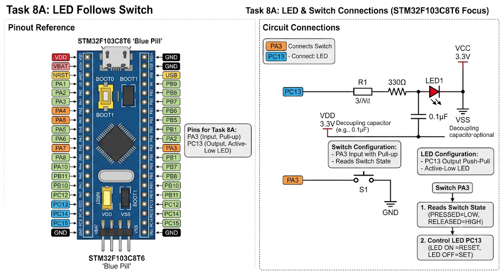

# STM32 GPIO – Switch-Controlled LED

A basic GPIO interfacing application using the STM32 HAL library. The firmware reads the state of a push-button switch connected to PA3 and controls an LED connected to PC13 accordingly.

The implementation uses continuous GPIO polling to monitor the switch and update the LED state in real time.

## Features

- Digital input reading through GPIO.
- LED control based on switch state.
- Internal GPIO pull-up configuration.
- Active-low LED operation.
- Continuous input polling without software delay loops.

## Hardware Configuration

| Pin | Configuration | Function |
|---|---|---|
| PA3 | Input with Pull-up | Reads switch state |
| PC13 | Output Push-Pull | Controls LED |

## Working Principle

The application continuously monitors PA3 using `HAL_GPIO_ReadPin()`.

- **Switch Pressed:** PA3 reads LOW (`GPIO_PIN_RESET`), turning the LED ON.
- **Switch Released:** PA3 reads HIGH (`GPIO_PIN_SET`), turning the LED OFF.

PC13 is connected to an active-low LED, so its output logic is inverted:

| GPIO Output | LED State |
|---|---|
| `GPIO_PIN_RESET` | ON |
| `GPIO_PIN_SET` | OFF |

## How It Works

1. Initializes the STM32 HAL library and system clock.
2. Configures PA3 as an input with an internal pull-up.
3. Configures PC13 as a push-pull output.
4. Initializes the LED to the OFF state.
5. Continuously reads the switch input.
6. Updates the LED output according to the switch state.

## Clock Configuration

The system clock uses an external High-Speed Oscillator (HSE) with PLL.

| Parameter | Configuration |
|---|---|
| Oscillator Source | HSE |
| PLL Source | HSE |
| PLL Multiplier | ×9 |
| AHB Prescaler | 1 |
| APB1 Prescaler | 2 |
| APB2 Prescaler | 1 |

## Requirements

- STM32 development board
- LED connected to PC13
- Push-button switch connected to PA3
- STM32CubeIDE
- STM32 HAL Library
  
## Circuit Diagram

## Behaviour

The LED directly follows the switch state: pressing the switch turns the LED ON, and releasing it turns the LED OFF.

