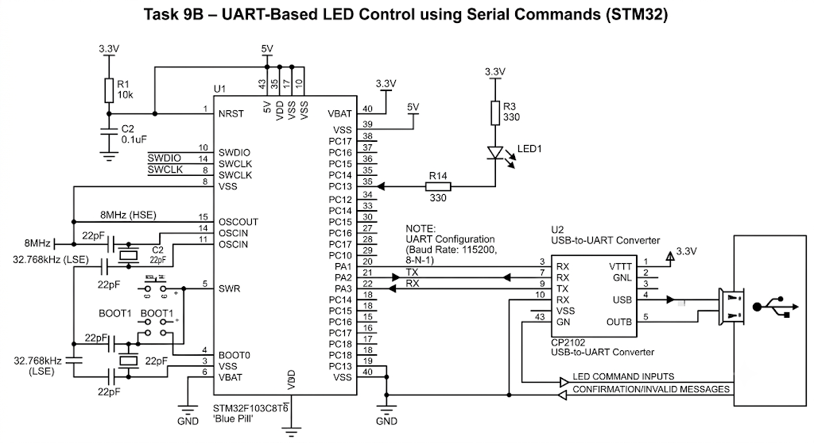

# STM32 UART-Based LED Control

A command-driven LED control application using USART2 and the STM32 HAL library. The firmware receives text commands from a serial terminal, interprets them, and controls an LED connected to GPIO pin PC13.

The application supports direct LED control, continuous blinking, and command validation through UART communication.

## Features

- UART-based command input through USART2.
- Character-by-character command reception.
- Command buffering and string comparison.
- LED ON and OFF control.
- Continuous LED toggling with a 300 ms interval.
- UART character echo and command status messages.
- Invalid command detection.
- Non-blocking UART reception during LED toggling to detect exit input.

## Supported Commands

| Command | Function |
|---|---|
| `LED ON` | Turns the LED ON |
| `LED OFF` | Turns the LED OFF |
| `LED TOGGLE` | Continuously toggles the LED |
| Any unsupported command | Returns `INVALID` |

## Hardware Configuration

| Component | Configuration |
|---|---|
| Microcontroller | STM32 |
| LED GPIO | PC13 |
| GPIO Mode | Output Push-Pull |
| UART Peripheral | USART2 |

**Note:** PC13 is configured for an active-low LED. Writing `GPIO_PIN_RESET` turns it ON, while `GPIO_PIN_SET` turns it OFF.

## UART Configuration

| Parameter | Value |
|---|---|
| Peripheral | USART2 |
| Baud Rate | 115200 |
| Word Length | 8 Bits |
| Stop Bits | 1 |
| Parity | None |
| Mode | Transmit & Receive |
| Hardware Flow Control | None |
| Oversampling | 16 |

## How It Works

The firmware continuously receives characters from USART2 and builds a command string in a character buffer.

1. Each received character is echoed back to the serial terminal.
2. Characters are stored in `c[20]`.
3. A carriage return (`\r`) or newline (`\n`) indicates the end of a command.
4. The completed string is compared against supported commands using `strcmp()`.
5. The corresponding GPIO operation is performed, and a response is transmitted over UART.

### Command Execution

**`LED ON`**

Sets PC13 to `GPIO_PIN_RESET`, activating the LED, and sends a confirmation message.

**`LED OFF`**

Sets PC13 to `GPIO_PIN_SET`, deactivating the LED, and sends a confirmation message.

**`LED TOGGLE`**

Enters a continuous blinking loop using:

```c
HAL_GPIO_TogglePin();
HAL_Delay(300);
```

The firmware periodically checks USART2 for incoming data using a zero-timeout (non-blocking) receive operation. Receiving a character exits the toggling loop.

**Invalid Commands**

Commands that do not match the supported strings return `INVALID`.

## Command Buffer Handling

The application uses a 20-byte character buffer to assemble incoming commands.

- Characters are received individually.
- A maximum of 19 characters is stored, reserving one byte for the null terminator.
- The buffer is null-terminated when a command-ending character is received.
- `strcmp()` is used for command identification.
- The buffer index is reset after command processing.

## Clock Configuration

The system clock uses an external High-Speed Oscillator (HSE) with PLL.

| Parameter | Configuration |
|---|---|
| Oscillator Source | HSE |
| PLL Source | HSE |
| PLL Multiplier | ×9 |
| AHB Prescaler | 1 |
| APB1 Prescaler | 2 |
| APB2 Prescaler | 1 |

## Requirements

- STM32 development board
- LED connected to PC13
- STM32CubeIDE
- STM32 HAL Library
- Serial terminal application (PuTTY or equivalent)
- 
## Circuit Diagram


## Testing

Connect to USART2 using a serial terminal configured for **115200 baud, 8-N-1**.

Enter the supported commands followed by Enter and observe the LED response and UART feedback.

